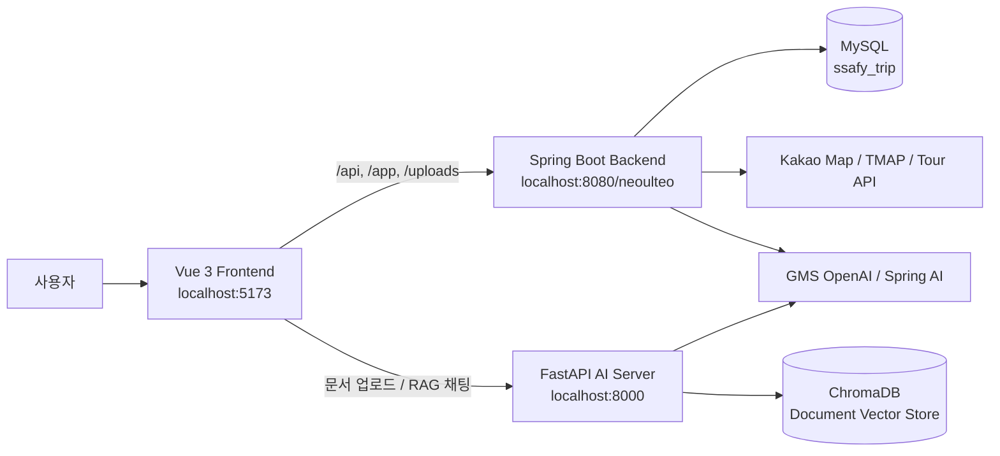

# Neoulteo

**Neoulteo**는 공공 관광 데이터와 지도를 기반으로 여행지를 탐색하고, 관심 장소를 저장하며, 일자별 여행 코스를 만들고 공유할 수 있는 여행 플랫폼입니다.
Vue 3 프론트엔드, Spring Boot 백엔드, FastAPI 기반 문서 RAG AI 서버로 구성되어 있습니다.

## 주요 기능

### 여행지 탐색

- 전국 시도/구군/콘텐츠 유형/키워드 기반 관광지 검색
- 검색 결과와 Kakao Map 마커 연동
- 관광지 상세 정보, 주소, 좌표, 이미지 확인
- 관심 장소 저장 후 여행 계획에서 재사용

### 여행 계획

- 여행 제목과 전체 여행 일수 설정
- 관광지 또는 핫플레이스를 일자별 코스에 추가
- 장소 순서 변경, 삭제, 일차 추가/변경
- 지도에서 선택한 일차의 이동 경로 확인
- TMAP 기반 자동차/도보 경로 계산
- 가까운 장소 기준의 간단한 동선 최적화
- 여행 계획 저장, 수정, 삭제
- 공유 코드 발급, 공유 계획 조회, 내 계획으로 복사
- AI 기반 코스 평가와 동선 재정렬 제안

### 핫플레이스

- 사용자 추천 핫플레이스 조회
- 지역별 인기 핫플레이스 TOP 5 확인
- 내 핫플레이스 등록, 수정, 삭제
- 기존 관광지 DB와 연결된 검증된 장소만 핫플레이스로 등록
- 핫플레이스를 관심 장소나 커뮤니티 글 작성 흐름으로 연결

### 커뮤니티

- 공지사항, 자유게시판, 여행지 후기, Q&A, 여행 계획 공유 카테고리
- 게시글 목록, 상세, 작성, 수정, 삭제
- 제목/내용/작성자 검색과 최신순/조회순/좋아요순 정렬
- 대표 이미지 업로드
- 댓글 작성/삭제
- 게시글 좋아요
- 여행 계획 공유 게시글에서 코스 확인 및 복사

### 회원

- 회원가입, 로그인, 로그아웃
- JWT 토큰 기반 인증과 Remember Me 저장 옵션
- 비밀번호 BCrypt 암호화
- 내 정보 조회, 이름 변경, 비밀번호 변경
- 이메일과 이름 기반 비밀번호 재설정
- 회원 탈퇴

### AI

- Spring AI 기반 여행 챗봇
- 관광지 DB, RAG 검색, 도구 실행 결과를 결합한 여행 답변
- 여행 코스 평가 API
- FastAPI 기반 PDF/TXT/MD 문서 업로드 및 문서 RAG 질의응답
- GMS OpenAI 키가 없거나 AI가 비활성화된 경우 대체 응답 제공

### 배치

- 한국관광공사 Tour API 데이터 수집
- 기존 관광지 데이터와 신규/변경/삭제 후보 비교
- AI 변경 요약
- PDF 비교 보고서 생성
- Spring Batch 실행 이력 저장

## 기술 스택

| 구분 | 기술 |
| --- | --- |
| Frontend | Vue 3, Vue Router, Vite, JavaScript, CSS |
| Map | Kakao Maps JavaScript SDK |
| Backend | Java 17, Spring Boot 3.3.5, Spring Security, Spring Batch, Spring AI |
| Persistence | MyBatis, MySQL |
| Routing | TMAP API |
| AI Server | Python, FastAPI, OpenAI API, sentence-transformers, ChromaDB |
| Document/PDF | pypdf, OpenHTMLToPDF |
| Build | pnpm, Maven |

## 시스템 구조



## 프로젝트 구조

```text
.
├─ frontend/                 Vue 3 클라이언트
│  ├─ src/api/               백엔드 및 AI 서버 호출 모듈
│  ├─ src/components/        지도, 챗봇, 홈 화면 컴포넌트
│  ├─ src/pages/             라우트별 화면
│  ├─ src/stores/            인증 상태
│  └─ src/utils/             여행 코스 평가 유틸
├─ backend/                  Spring Boot API 서버
│  └─ src/main/
│     ├─ java/com/neoulteo/
│     │  ├─ domain/          회원, 관광지, 핫플, 계획, 게시글
│     │  ├─ ai/              Spring AI, RAG, Tool
│     │  ├─ batch/           Tour API 수집/비교/PDF
│     │  ├─ routing/         TMAP 경로 계산
│     │  └─ global/          보안, 공통 설정
│     └─ resources/          설정, schema.sql, MyBatis mapper
├─ ai-server/                FastAPI 문서 RAG 서버
├─ docs/                     설계 문서, 이미지, DB SQL
└─ storage/                  배치 PDF 등 로컬 생성 파일
```

## 실행 전 준비

필요한 런타임입니다.

- Java 17
- MySQL 8.x
- Node.js와 pnpm
- Python 3.10 이상
- Kakao JavaScript 앱 키
- TMAP 앱 키
- 선택: Tour API 서비스 키
- 선택: GMS OpenAI API 키

## DB 준비

기본 DB 이름과 계정은 `application.properties` 기준으로 `ssafy_trip`, `ssafy` / `ssafy`입니다.

```sql
CREATE DATABASE IF NOT EXISTS ssafy_trip
  DEFAULT CHARACTER SET utf8mb4
  COLLATE utf8mb4_unicode_ci;

CREATE USER IF NOT EXISTS 'ssafy'@'localhost' IDENTIFIED BY 'ssafy';
GRANT ALL PRIVILEGES ON ssafy_trip.* TO 'ssafy'@'localhost';
FLUSH PRIVILEGES;
```

스키마와 관광지 dump를 넣습니다.

```powershell
mysql -u ssafy -p ssafy_trip < backend/src/main/resources/schema.sql
mysql -u ssafy -p ssafy_trip < docs/database/SSAFY_TRIP_Dump.sql
```

개발용 핫플레이스 seed가 필요하면 추가로 실행합니다.

```powershell
mysql -u ssafy -p ssafy_trip < docs/dev-seed-hotplaces.sql
```

Spring Boot 실행 시 `spring.sql.init.mode=always` 설정으로 `schema.sql`이 자동 실행됩니다. 운영 또는 실제 발표 환경에서는 데이터 초기화 정책을 상황에 맞게 조정하세요.

## Backend 실행

로컬 비밀 값은 환경 변수로 주거나, Git에 올리지 않는 `backend/src/main/resources/application-local.properties`에 따로 둘 수 있습니다.

주요 설정 값:

```properties
TOUR_API_SERVICE_KEY=한국관광공사_Tour_API_키
TMAP_APP_KEY=TMAP_앱_키
GMS_OPENAI_API_KEY=GMS_OpenAI_키
GMS_OPENAI_MODEL=gpt-4o-mini
NEOULTEO_AI_ENABLED=false
COMMUNITY_ADMIN_EMAILS=a@a
```

실행:

```powershell
cd backend
.\mvnw.cmd spring-boot:run
```

백엔드 기본 주소:

```text
http://localhost:8080/neoulteo
```

## Frontend 실행

`frontend/.env` 파일을 만들고 Kakao Map JavaScript 키를 설정합니다.

```env
VITE_KAKAO_MAP_APP_KEY=본인_Kakao_JavaScript_키
```

Kakao Developers의 Web platform domain에는 아래 주소를 등록합니다.

```text
http://localhost:5173
http://127.0.0.1:5173
```

실행:

```powershell
cd frontend
pnpm install
pnpm dev
```

프론트엔드 주소:

```text
http://localhost:5173
```

Vite 개발 서버는 `/api`, `/app`, `/uploads` 요청을 `http://localhost:8080/neoulteo`로 프록시합니다.

## FastAPI AI 서버 실행

문서 업로드, 벡터 검색, FastAPI RAG 채팅을 쓰려면 별도 AI 서버를 실행합니다.

```powershell
cd ai-server
python -m venv .venv
.\.venv\Scripts\Activate.ps1
python -m pip install --upgrade pip
pip install -r requirements.txt

$env:GMS_OPENAI_API_KEY="GMS_OpenAI_키"
$env:GMS_OPENAI_BASE_URL="https://gms.ssafy.io/gmsapi/api.openai.com/v1"
$env:GMS_OPENAI_MODEL="gpt-4o-mini"

uvicorn main:app --reload --port 8000
```

FastAPI 문서:

```text
http://127.0.0.1:8000/docs
```

`ai-server/data` 폴더에 있는 PDF/TXT/MD 파일은 서버 시작 시 벡터 DB에 적재됩니다. 실행 중 `/upload` API로 문서를 추가할 수도 있습니다.

## 화면 경로

| 경로 | 화면 |
| --- | --- |
| `/` | 홈, 지역 지도, 지역별 핫플레이스 요약 |
| `/attractions` | 관광지 검색 |
| `/plans` | 여행 계획 작성/관리 |
| `/hotplaces` | 공개 핫플레이스 |
| `/hotplaces/my` | 내 핫플레이스 관리 |
| `/community` | 커뮤니티 목록 |
| `/community/write` | 커뮤니티 글 작성 |
| `/community/:id` | 커뮤니티 상세 |
| `/profile` | 마이페이지 |

## 주요 API

백엔드 기본 경로는 `http://localhost:8080/neoulteo`입니다.

| 도메인 | Method | Endpoint | 설명 |
| --- | --- | --- | --- |
| User | `POST` | `/api/users/signup` | 회원가입 |
| User | `GET/PATCH/DELETE` | `/api/users/me` | 내 정보 조회/수정/탈퇴 |
| User | `POST` | `/api/users/password-reset` | 비밀번호 재설정 |
| Auth | `POST` | `/api/auth/login` | 로그인 |
| Auth | `POST` | `/api/auth/logout` | 로그아웃 |
| Attraction | `GET` | `/api/attractions` | 관광지 검색 |
| Attraction | `GET` | `/api/attractions/sidos` | 시도 목록 |
| Attraction | `GET` | `/api/attractions/guguns` | 구군 목록 |
| Hotplace | `GET` | `/api/hotplaces` | 공개 핫플레이스 조회 |
| Hotplace | `GET` | `/api/hotplaces/popular` | 인기 핫플레이스 조회 |
| Hotplace | `GET/POST` | `/api/hotplaces/me`, `/api/hotplaces` | 내 핫플레이스 조회/등록 |
| Hotplace | `PATCH/DELETE` | `/api/hotplaces/{id}` | 내 핫플레이스 수정/삭제 |
| Saved Place | `GET/POST` | `/api/saved-places` | 관심 장소 조회/저장 |
| Saved Place | `DELETE` | `/api/saved-places/{id}` | 관심 장소 삭제 |
| Plan | `GET/POST` | `/api/plans` | 내 여행 계획 조회/저장 |
| Plan | `GET/PATCH/DELETE` | `/api/plans/{id}` | 여행 계획 상세/수정/삭제 |
| Plan | `PATCH` | `/api/plans/{id}/share` | 공유 상태 변경 |
| Plan | `GET` | `/api/plans/shared/{id}` | 공유 계획 조회 |
| Plan | `POST` | `/api/plans/{id}/copy` | 공유 계획 복사 |
| Route | `POST` | `/api/routes/plan` | TMAP 경로 계산 |
| Community | `GET/POST` | `/api/posts` | 게시글 목록/작성 |
| Community | `GET/PUT/DELETE` | `/api/posts/{id}` | 게시글 상세/수정/삭제 |
| Community | `GET/POST` | `/api/posts/{id}/comments` | 댓글 조회/작성 |
| Community | `DELETE` | `/api/posts/comments/{commentId}` | 댓글 삭제 |
| Community | `POST` | `/api/posts/{id}/like` | 좋아요 토글 |
| Community | `POST` | `/api/posts/images` | 대표 이미지 업로드 |
| AI | `POST` | `/app/ai/chat` | 기본 AI 채팅 |
| AI | `POST` | `/app/ai/smart-travel-chat` | Tool 기반 여행 채팅 |
| AI | `POST` | `/app/ai/evaluate-plan` | 여행 코스 평가 |
| AI | `POST` | `/app/ai/travel-assistant` | RAG + Tool 여행 도우미 |
| Batch | `POST` | `/api/batch/tour` | Tour API 배치 실행 |

FastAPI 서버:

| Method | Endpoint | 설명 |
| --- | --- | --- |
| `POST` | `/chat` | 일반 AI 채팅 |
| `POST` | `/search` | 문서 벡터 검색 |
| `POST` | `/integrated-chat` | 문서 검색 기반 통합 채팅 |
| `POST` | `/upload` | PDF/TXT/MD 문서 업로드 |

## 주요 테이블

| 테이블 | 역할 |
| --- | --- |
| `users` | 회원 정보 |
| `sidos`, `guguns` | 지역 코드 |
| `contenttypes` | 관광 콘텐츠 유형 |
| `attractions` | 공공 관광지 데이터 |
| `hotplaces` | 사용자 추천 핫플레이스 |
| `travel_plans` | 여행 계획 기본 정보와 공유 상태 |
| `travel_plan_places` | 여행 계획 장소, 일차, 순서 |
| `saved_places` | 관심 장소 |
| `posts` | 커뮤니티 게시글 |
| `post_comments` | 댓글 |
| `post_likes` | 좋아요 |
| `tour_batch_reports` | Tour API 배치 비교 보고서 |
| `batch_*` | Spring Batch 실행 이력 |

## 빌드 확인

Backend:

```powershell
cd backend
.\mvnw.cmd -q -DskipTests package
```

Frontend:

```powershell
cd frontend
pnpm build
```

## 참고 문서

- `docs/화면설계파일.pdf`
- `docs/고찰보고서.pdf`
- `docs/database/schema.sql`
- `docs/database/SSAFY_TRIP_Dump.sql`
- `docs/database/migrations/`
- `docs/spring-ai-tool-module.md`
- `docs/routing-setup.md`

## Git에서 제외해야 하는 파일

아래 파일과 폴더는 로컬 실행 산출물 또는 비밀 값이므로 Git에 올리지 않습니다.

```text
frontend/.env
frontend/node_modules/
frontend/dist/
backend/target/
backend/src/main/resources/application-local.properties
ai-server/.venv/
ai-server/chroma_data/
ai-server/__pycache__/
storage/
uploads/
.idea/
*.iml
```
